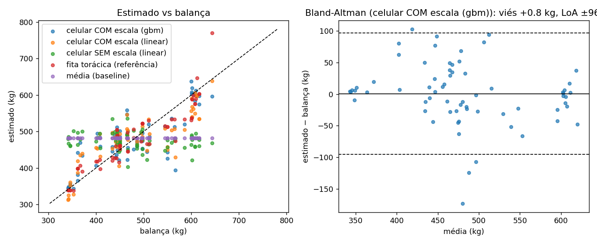

# Celular, 1 foto lateral, 67 bovinos Horqin (Mendeley, CC BY 4.0) - leave-one-animal-out

Segmentador YOLOv8n-seg genérico (classe COCO cow), features de silhueta. "COM escala" usa a cernelha medida como escala (simula o que LiDAR ou marcador entregam). Faixa 341 a 644 kg.

| modelo | n | MAPE % | MAE kg | RMSE kg | viés % | R² | ≤3% | ≤5% | lote(30) MAPE % |
|---|---|---|---|---|---|---|---|---|---|
| celular COM escala (gbm) | 67 | 7.42 | 35.0 | 48.7 | +1.04 | 0.67 | 37% | 48% | 1.11 |
| celular COM escala (linear) | 67 | 8.09 | 38.5 | 47.4 | +0.48 | 0.69 | 19% | 34% | 1.14 |
| celular SEM escala (linear) | 67 | 16.77 | 78.9 | 92.8 | +1.68 | -0.18 | 6% | 18% | 2.56 |
| fita torácica (referência) | 67 | 5.42 | 26.8 | 34.8 | +0.22 | 0.83 | 31% | 54% | 0.85 |
| média (baseline) | 67 | 15.27 | 70.7 | 85.5 | +3.28 | 0.00 | 13% | 22% | 1.92 |

