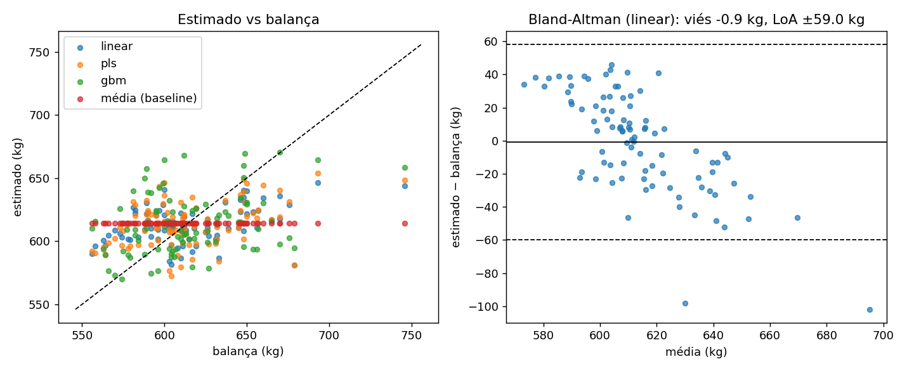

# CowDatabase2 (Angus, Kinect v2, vista dorsal) - leave-one-animal-out

96 animais, 1 frame dorsal cada, faixa 556 a 746 kg (CV 5%). Dataset de validação do pipeline, não benchmark de precisão: a própria circunferência torácica manual só correlaciona r=0,54 com o peso nesta base.

| modelo | n | MAPE % | MAE kg | RMSE kg | viés % | R² | ≤3% | ≤5% | lote(30) MAPE % |
|---|---|---|---|---|---|---|---|---|---|
| linear | 91 | 3.92 | 24.3 | 30.0 | +0.08 | 0.17 | 40% | 68% | 0.59 |
| pls | 91 | 3.99 | 24.6 | 30.3 | +0.08 | 0.15 | 42% | 66% | 0.60 |
| gbm | 91 | 4.20 | 26.0 | 33.5 | +0.13 | -0.04 | 52% | 73% | 0.65 |
| média (baseline) | 91 | 4.10 | 25.4 | 32.9 | +0.28 | 0.00 | 45% | 64% | 0.66 |

