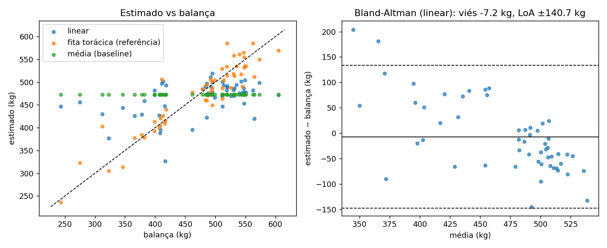

# CowDB (Hereford, Kinect v2, dorsal), bloco 97-154 - leave-one-animal-out

ATENÇÃO: o pareamento imagem-rótulo deste dataset público é inconsistente (a altura medida na imagem só correlaciona r=0,38 com a cernelha manual; no bloco 1-96 o volume não correlaciona com o peso). Serve para validar o pipeline, não a precisão. Faixa 243 a 605 kg.

| modelo | n | MAPE % | MAE kg | RMSE kg | viés % | R² | ≤3% | ≤5% | lote(30) MAPE % |
|---|---|---|---|---|---|---|---|---|---|
| linear | 54 | 13.74 | 57.9 | 71.5 | +1.40 | 0.20 | 13% | 26% | 2.12 |
| fita torácica (referência) | 54 | 4.85 | 21.8 | 29.8 | +0.24 | 0.86 | 46% | 72% | 0.67 |
| média (baseline) | 54 | 16.05 | 66.4 | 80.1 | +3.73 | 0.00 | 9% | 20% | 1.71 |

